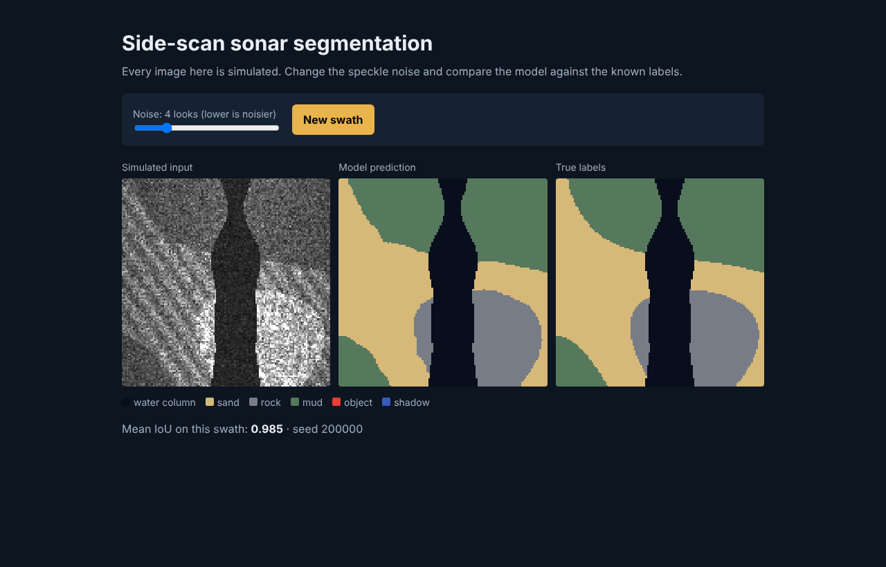

# Side-scan sonar segmentation pipeline


**[Live demo](https://YOUR_DEMO_URL)**

A repeatable pipeline that simulates sonar imagery, trains a U-Net, tracks experiments in MLflow, and only releases a model that passes a quality gate.

> **All data is simulated.** No proprietary data is used, and scores describe this simulator, not real sonar.



## Results
300 unseen simulated images. Full numbers are in [`reports/evaluation.json`](reports/evaluation.json).

| Class | U-Net IoU | Baseline IoU |
|---|---:|---:|
| Water column | 0.998 | 0.839 |
| Sand | 0.940 | 0.608 |
| Rock | 0.982 | 0.429 |
| Mud | 0.986 | 0.460 |
| Object | 0.840 | 0.009 |
| Shadow | 0.970 | 0.004 |
| **Mean** | **0.953** | **0.392** |

Accuracy falls as noise rises: mean IoU is 0.963 at 8 looks, 0.953 at the training level of 4, 0.884 at 2, and 0.523 at 1. Inference took about 24 ms per 128x128 image on CPU.

## Run it
```bash
pip install -r requirements-dev.txt
make check        # lint and tests
make pipeline     # train, evaluate, gate
make experiments  # MLflow UI
make serve        # http://localhost:8000
```

## Development lifecycle
| Stage | Where |
|---|---|
| Requirements | [docs/requirements.md](docs/requirements.md) |
| Design and decisions | [docs/design.md](docs/design.md), [docs/adr](docs/adr) |
| Testing | [docs/test-plan.md](docs/test-plan.md), [tests](tests) |
| CI/CD | [.github/workflows/ci.yml](.github/workflows/ci.yml), [Dockerfile](Dockerfile) |
| Operations | [docs/runbook.md](docs/runbook.md) |

## How this was built

Built with AI assistance (Claude). Commit messages credit it as co-author. I reviewed the design and can explain the tradeoffs.
