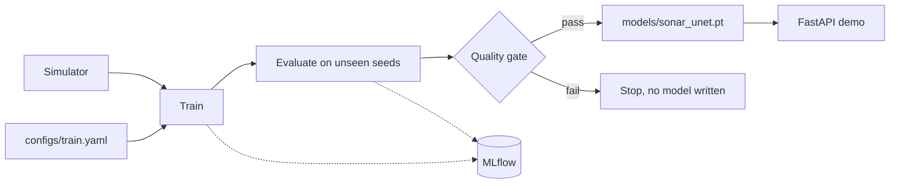

# Design

## Simulator
Models class-specific texture, falling echo strength with range, a water column at nadir, bright objects with shadows that lengthen with range, and gamma speckle.

## Model
A three-level U-Net with weighted cross-entropy, because objects and shadows cover about 1% of pixels. Mean IoU is the headline metric so rare classes count equally.

## Evaluation
A blur-and-nearest-intensity baseline is fitted on separate simulated data. The test set is 300 unseen seeds. Speckle is then varied beyond its training value to measure robustness.

## Gate
The model file is only written if the test mIoU meets `min_test_miou` and beats the baseline by `min_margin_over_baseline`. Both are set in `configs/train.yaml`.
